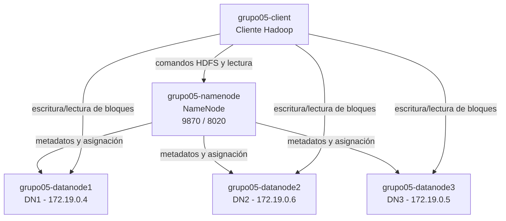

# LG15 - Tolerancia a fallos y replicación de datos en HDFS

## 1. Descripción del proyecto

Este proyecto implementa y evalúa un clúster HDFS con un **NameNode**, tres
**DataNodes** y un cliente Hadoop. El objetivo es observar qué ocurre cuando
un DataNode deja de estar disponible y comprobar si HDFS mantiene el acceso al
archivo, detecta los bloques subreplicados y crea nuevas réplicas.

El trabajo se relaciona con **LG14** porque utiliza la arquitectura y los
conceptos de Hadoop/HDFS estudiados allí: NameNode, DataNodes, bloques,
factor de replicación, comandos HDFS y monitoreo del clúster. LG15 amplía esa
base con pruebas controladas de fallo y recuperación automática.

Se ejecutaron dos experimentos:

- Archivo de **1 GB**, con replicación 2; se detuvo el DataNode 2.
- Archivo de **10 GB**, con replicación 2; se detuvo el DataNode 3.

## 2. Arquitectura y diagrama

La configuración se encuentra en [`docker-compose.yml`](./docker-compose.yml).
El NameNode administra los metadatos y la ubicación de los bloques; los
DataNodes almacenan las réplicas; y el cliente ejecuta las operaciones HDFS.



Mapa de direcciones: [`mapa_ips.txt`](./grupo05_resultados/mapa_ips.txt).

Capturas generales del clúster:

- [Contenedores activos](./grupo05_evidencias/01-dockerps.png)
- [DataNodes en la interfaz web](./grupo05_evidencias/02-datanodes_web.png)
- [Reporte inicial](./grupo05_evidencias/03-report_inicial.png)
- [Configuración HDFS](./grupo05_evidencias/04-configuracion.png)
- [Mapa de IPs](./grupo05_evidencias/05-mapa_ips.png)
- [Directorios HDFS](./grupo05_evidencias/06-directorios_hdfs.png)

## 3. Requisitos

- Docker Desktop con Docker Compose.
- PowerShell.
- Espacio suficiente en disco para las imágenes y los archivos de prueba.
- Puertos `9870` y `8020` disponibles.

Verificar la instalación:

```powershell
docker --version
docker compose version
```

## 4. Instalación y ejecución

Ejecutar los comandos desde la carpeta raíz del repositorio.

### Fase 2: levantar y verificar el clúster

```powershell
docker compose up -d
docker ps
docker exec grupo05-client hdfs dfsadmin -report
docker exec grupo05-client hdfs dfsadmin -safemode get
```

La interfaz web del NameNode queda disponible en
<http://localhost:9870>. Para detener y eliminar el clúster:

```powershell
docker compose down
```

### Fase 4: cargar datos y ejecutar la prueba

Los scripts se encuentran en [`grupo05_scripts/`](./grupo05_scripts/).
Cada experimento debe ejecutarse con el clúster levantado. Primero se carga el
archivo con replicación 2:

```powershell
.\grupo05_scripts\cargar-dataset.ps1 -Dataset 1GB -Etiqueta 01-carga
.\grupo05_scripts\cargar-dataset.ps1 -Dataset 10GB -Etiqueta 01-carga
```

La opción `-Dataset` acepta `1GB` o `10GB`; la carga usa bloques de 128 MB y
establece la replicación en 2 mediante `dfs.replication=2`.

Para guardar el estado inicial:

```powershell
.\grupo05_scripts\estado.ps1 -Dataset 1GB -Etiqueta 03-estado-inicial
.\grupo05_scripts\estado.ps1 -Dataset 10GB -Etiqueta 03-estado-inicial
```

En otra ventana de PowerShell se puede iniciar el monitor:

```powershell
.\grupo05_scripts\monitor.ps1 -Dataset 1GB -Segundos 30
.\grupo05_scripts\monitor.ps1 -Dataset 10GB -Segundos 30
```

Durante cada prueba se detiene el DataNode indicado:

```powershell
# Prueba de 1 GB
docker stop grupo05-datanode2

# Prueba de 10 GB
docker stop grupo05-datanode3
```

Después de observar la detección y la recuperación, se restaura el contenedor:

```powershell
docker start grupo05-datanode2
docker start grupo05-datanode3
```

El estado final se comprueba con:

```powershell
docker exec grupo05-client hdfs dfsadmin -report
docker exec grupo05-client hdfs fsck /grupo05/dataset_1GB -files -blocks -locations
docker exec grupo05-client hdfs fsck /grupo05/dataset_10GB -files -blocks -locations
```

Los scripts guardan sus respaldos de texto en
`grupo05_evidencias\1GB\` o `grupo05_evidencias\10GB\`. Las capturas y los
respaldos organizados que se entregan están en
`grupo05_evidencias\grupo05_1GB\` y `grupo05_evidencias\grupo05_10GB\`.

## 5. Resultados del experimento de 1 GB

| Aspecto | Resultado |
|---|---|
| Archivo | `dataset_grupo05_1GB` |
| Factor de replicación | 2 |
| Tamaño de bloque | 128 MB |
| Número de bloques | 8 |
| DataNode detenido | DN2 (`172.19.0.6`) |
| Bloques que tenía el nodo detenido | 7 |
| Bloques faltantes | 0 |
| Archivo accesible durante el fallo | Sí; el cliente utilizó la réplica disponible |
| Estado final | `HEALTHY`, sin bloques faltantes ni subreplicados |
| Integridad | Hash MD5 igual antes y durante/después de la falla |

Evidencias:

- [Carga del archivo](./grupo05_evidencias/grupo05_1GB/01-carga.png)
- [Estado y bloques iniciales](./grupo05_evidencias/grupo05_1GB/03-estado-inicial.txt)
- [Reporte durante el fallo](./grupo05_evidencias/grupo05_1GB/08-report_dn_caido.png)
- [FSCK con bloques subreplicados](./grupo05_evidencias/grupo05_1GB/09-fsck_subreplicados.png)
- [Prueba de lectura durante el fallo](./grupo05_evidencias/grupo05_1GB/07_md5_durante.png)
- [FSCK final](./grupo05_evidencias/grupo05_1GB/11-fsck_final.png)
- [Integridad después de la recuperación](./grupo05_evidencias/grupo05_1GB/12-md5_despues.png)
- [Línea de tiempo](./grupo05_evidencias/grupo05_1GB/monitor.txt)

## 6. Resultados del experimento de 10 GB

| Aspecto | Resultado |
|---|---|
| Archivo | `dataset_grupo05_10GB` |
| Factor de replicación | 2 |
| Tamaño de bloque | 128 MB |
| Número de bloques | 80 |
| DataNode detenido | DN3 (`172.19.0.5`) |
| Bloques subreplicados observados | 47 de 80 (58,75 %) |
| Promedio de replicación durante el fallo | 1,41 (según `fsck`) |
| Bloques faltantes | 0 |
| Archivo accesible durante el fallo | Sí; `wc` devolvió 10 737 418 240 bytes |
| Recuperación observada | 47 → 21 → 2 → 0 bloques subreplicados (según `fsck`) |
| Estado final | `HEALTHY`, promedio de replicación 2,0 |
| Tiempo aproximado | Detección: 9,9 min; recuperación: aproximadamente 7 min |

Evidencias:

- [Mapa de IP](./grupo05_evidencias/grupo05_10GB/00-mapa_ips.png)
- [Carga del archivo](./grupo05_evidencias/grupo05_10GB/01-carga.png)
- [Estado y bloques iniciales](./grupo05_evidencias/grupo05_10GB/03-estado-inicial.txt)
- [Reporte durante el fallo](./grupo05_evidencias/grupo05_10GB/08-report_dn_caido.png)
- [FSCK subreplicado](./grupo05_evidencias/grupo05_10GB/09-fsck_subreplicados.png)
- [Prueba de lectura durante el fallo](./grupo05_evidencias/grupo05_10GB/07-wc_durante.png)
- [Monitoreo de detección](./grupo05_evidencias/grupo05_10GB/monitor.txt)
- [Monitoreo de recuperación](./grupo05_evidencias/grupo05_10GB/monitor-fsck.txt)
- [FSCK final](./grupo05_evidencias/grupo05_10GB/12-fsck_final.png)
- [Integridad después de la recuperación](./grupo05_evidencias/grupo05_10GB/13-wc_despues.png)

> **Nota sobre el monitoreo:** durante la prueba de 10 GB, `dfsadmin -report`
> podía mostrar cero bloques subreplicados mientras `fsck` ya mostraba 47.
> Por eso la recuperación se midió con `monitor-fsck.txt`, que registra la
> evolución 47 → 21 → 2 → 0.

## 7. Tabla comparativa

> **Pendiente:**

## 8. Respuestas a las 9 preguntas

1. **¿Por qué sigue entregando el archivo?**  
   Porque cada bloque tiene otra réplica en un DataNode diferente. El cliente
   cambia automáticamente a la réplica disponible.

2. **¿Qué pasaría con replicación 1?**  
   Si falla el DataNode que contiene un bloque, ese bloque no podría leerse y
   el archivo podría quedar incompleto o inaccesible.

3. **¿Qué ocurriría si fallaran dos DataNodes?**  
   Los bloques cuyas dos réplicas estuvieran en esos nodos quedarían
   inaccesibles, con posible pérdida de datos.

4. **¿Por qué replicación 2 no son dos copias completas?**  
   HDFS replica cada bloque dos veces y distribuye los bloques entre los
   DataNodes; no guarda dos archivos completos en cada nodo.

5. **¿Cuál es el tamaño de bloque y el número de bloques?**  
   El bloque es de 128 MB. El archivo de 1 GB tiene 8 bloques y el de 10 GB
   tiene 80 bloques.

6. **¿Por qué 10 GB es más representativo?**  
   Porque utiliza más bloques y permite observar mejor los bloques afectados,
   la subreplicación y la recuperación automática.

7. **¿Qué bloques tenían réplica en el DataNode caído?**  
   En 1 GB, el DN2 tenía 7 de los 8 bloques. En 10 GB se observaron 47 bloques
   subreplicados al detener el DN3, pero no hubo bloques faltantes.

8. **¿Quién administra la ubicación y replicación?**  
   El NameNode administra los metadatos, decide la ubicación de las réplicas y
   ordena su recuperación. El cliente solicita y lee los bloques.

9. **¿Cuál es la diferencia entre disponibilidad y cumplimiento de replicación?**  
   La disponibilidad significa que el archivo puede leerse. El cumplimiento
   de replicación significa que cada bloque tiene la cantidad configurada de
   copias. Un archivo puede estar disponible aunque temporalmente esté
   subreplicado.

## 9. Estructura del repositorio

```text
bigdata_Grupo5_LG15/
├── docker-compose.yml
├── README.md
├── grupo05_docs/
│   └── Preguntas.docx
├── grupo05_scripts/
│   ├── cargar-dataset.ps1
│   ├── estado.ps1
│   └── monitor.ps1
├── grupo05_evidencias/
│   ├── 01-dockerps.png
│   ├── 02-datanodes_web.png
│   ├── 03-report_inicial.png
│   ├── 04-configuracion.png
│   ├── 05-mapa_ips.png
│   ├── 06-directorios_hdfs.png
│   ├── grupo05_1GB/
│   ├── grupo05_10GB/
│   └── 1GB/
└── grupo05_resultados/
    └── mapa_ips.txt
```

Las carpetas de evidencias contienen tanto las capturas como los archivos de
respaldo `.txt` generados por los scripts. La carpeta `1GB/` puede contener
el monitor generado por una ejecución anterior; las evidencias principales
están organizadas en `grupo05_1GB/` y `grupo05_10GB/`.

## 10. Observaciones y limitaciones

- La detección del DataNode caído tarda aproximadamente 9,9 minutos con la
  configuración utilizada. Esto se debe al intervalo de heartbeat y al
  tiempo de revalidación configurados en HDFS.
- Los tres DataNodes comparten el almacenamiento del entorno Docker, por lo
  que la capacidad reportada puede aparecer repetida en los informes.
- La prueba de 1 GB se realizó deteniendo DN2 y la de 10 GB deteniendo DN3;
  por tanto, los resultados no representan exactamente el mismo patrón de
  distribución de bloques.
- La disponibilidad del archivo y el cumplimiento del factor de replicación
  son propiedades diferentes: el archivo puede seguir leyéndose mientras
  existen bloques temporalmente subreplicados.
